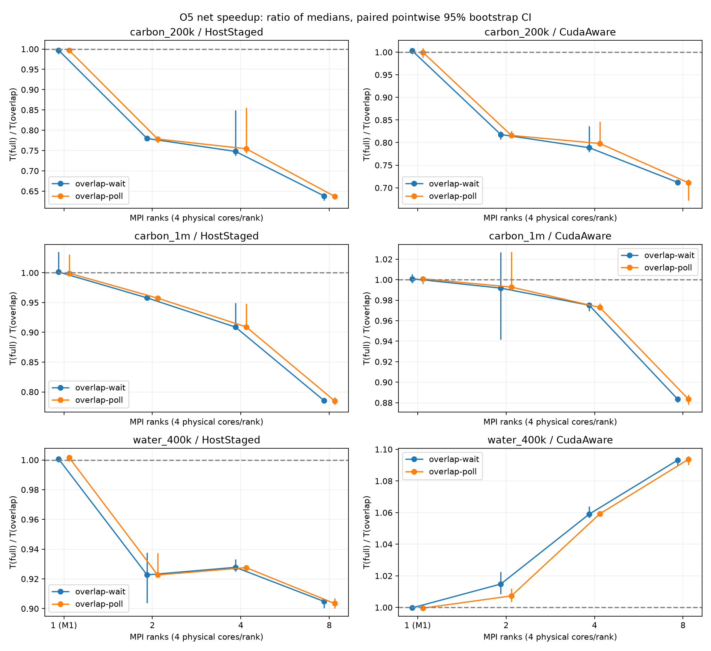

# 通信与计算交叠性能实测

目标：按执行阶段记录 O1 串行基线、O4 固定资源检查、O5 性能/成本归因及后续成本分析的身份、结果和结论边界。

| 日期 | 阶段 | 结论 | 适用范围与限制 |
| --- | --- | --- | --- |
| 2026-10-12 | [O1 串行通信/计算基线](#o1-20261012-report) | 执行了串行基准、trace 与 smoke/pilot，记录通信字节及请求/计算时间线。 | dirty 工作树；请求在途不等于链路传输，缺少绝对时钟校准与 UCX progress 证据，不宣称真实网络/GPU 交叠。 |
| 2026-10-16 | [O4 固定资源窄检查](#o4-20261016-report) | 固定 carbon_200k/P2 输入与 CPU 绑定，测量墙钟、CPU 成本和可重算的正常路径时间线。 | 窄样本不支持显著性或普遍加速；无 NIC/transport trace，不发布物理传输隐藏量或 overlap ratio。 |
| 2026-10-16、10-19、10-21 | [O5 正式性能与成本归因](#o5-20261021-report) | 完成冻结矩阵、正确性/资源门槛、主性能、诊断和独立采用验证；报告 PASS（本机冻结范围）。 | 不推出自动阈值或跨节点结论；各组样本、旧阶段与误差按原节分别保留。 |
| 2026-10-21 | [O5 后续成本分析](#o5-cost-20261021-report) | 拆解约 4.6 ms 新增成本，记录模式、kernel 实测和后续优化优先级。 | 成本拆分不能冒充纯单因果归因；时钟/完成误差与小接口成本仍 UNKNOWN/INCONCLUSIVE。 |

以下各节按来源报告记录执行身份、环境、历史命令、统计数据、失败与未覆盖边界；标题层级仅为嵌入整合文档而调整。

> **保留与适用边界（2026-11-05）：** 本文保存公共共享服务器历史测量的结果、结论和适用限制；这些数据属于历史探索，不作为专用性能服务器的基准参考。按授权清理了对应的忽略目录 `dmgmd-overlap-*`，逐 trial 输出、日志、trace、原始输入副本及重算工具均不再保留。下文残留的旧文件名、路径和命令仅记载当时执行过程，不能用来访问产物或复算。后续专用服务器 benchmark 将单独记录为性能参考；本报告的数字、结论和生产默认不变。


<a id="o1-20261012-report"></a>

<a id="o1-20261012-o1-串行通信计算基线2026-10-12"></a>

## O1 串行通信/计算基线（2026-10-12）

类别：实测/实现备忘。范围只到 O1：局部域分解原有串行路径的时间线、两后端 A/B 诊断编排、
CPU 与固定资源基线；没有 interior/boundary 分区或异步计算。所有速度数字是本机样本，
不是 O4/O5 的 overlap 收益。

<a id="o1-20261012-身份环境和资源映射"></a>

### 身份、环境和资源映射

- DMG-MD HEAD `8669fb4256efabe262ec5943d5589f3a245bc0d8`，实验时工作树 **dirty**，
  没有提交或推送。代码改动为 `include/dmgmd/mpi_runtime.hpp`、`src/domain_runtime.cu`、
  `src/mpi_runtime.cu`，编排/测试为 `tests/benchmark/run_benchmark.py`、
  `run_overlap_rebuild.py`、`test_benchmark.py`，文档为本页、benchmark README、
  `mpi-runtime.md`（当时名为 replicated-mpi.md）、`docs/README.md`。每个 benchmark 输出的 `metadata.json`、
  ``source-dirty.patch``
  与 `dirty_patch_sha256` 锁定该次运行时的 tracked diff：
  `ff19cc3d30b51f37be48d065c7d457ec5c6d0a3171ba74df6ef0babbecda9045`。
  新 runner 作为 untracked 文件由运行 metadata 的 `untracked_source_sha256` 或
  专用重建运行 metadata 的 `sources` 哈希保存。metadata 中本报告的 untracked
  哈希仅对应实验当时草稿；本页在数据收齐后更新，不作为二进制构建输入。
- 三个只读 reference HEAD 分别为 GPUMD
  `9d23496e41319b9e2af5221a7df6285387401d1e`、LAMMPS
  `611ca3b7f8525ba802373b04f9e3d632d515f7e3`、MatPL
  `21fabf34eadc57a717f4c7fbce9bb80aad5fd991`。前后 tracked 状态均干净；
  GPUMD 原有忽略的 `build/` 文件最晚早于本日，本轮三个参考目录均无本日新增文件。
- 主机 `n4`，Linux `5.15.0-60-generic`，AMD EPYC 7K62（2 NUMA），Open MPI 5.0.10、
  UCX 1.22.0、CUDA Toolkit 12.9、NVIDIA driver 580.173.02。GPU0/1 为 RTX 4090，
  UUID 分别 `GPU-a4cdc2a3-d216-af6d-26bb-d6a5c81e2a80`、
  `GPU-d146f2b8-3d3d-4b60-b4a5-1b9ed07f2900`，均邻近 NUMA0。
- P=2 的每次正式/诊断启动使用 Open MPI
  `--map-by ppr:2:numa:PE=4 --bind-to core --report-bindings`，rank 0/1 的 GPU UUID
  与 `DMGMD_MPI` 及 C1 映射一致。C1 从实际 `/proc` task affinity 和 core/package/NUMA
  拓扑核验：rank 0 为逻辑 CPU `0-3,96-99`（物理核 0–3）、rank 1 为
  `4-7,100-103`（物理核 4–7），两者均 NUMA0、无交叠。GPU/CPU 对应在每个
  `--cpu-sampling proc` trial 的 `result.json.cpu_binding` 和 `cpu/summary.json.mappings`
  留证。`--cpu-sampling off` 组保留逐 trial `--report-bindings` stderr，但没有 C1 的
  逐 trial task 快照，仅作为采样器关闭的对照。
- CPU memory policy 是宿主默认策略，未通过 CPU affinity 推断内存页实际 NUMA；C1
  容量层次在本次观测为 `hierarchy_complete=false`，不发布完整 quota 归一化。
  GPU 使用/温度/时钟逐 trial 在 `telemetry.jsonl` 与 metadata；没有锁频或排他调度证明。

交付测量二进制 SHA-256：`fa6ad163ce84c3ae2bfc1638553847cd5767c67db0c27cc5a59c4176c8e823eb`。
源码 SHA-256：`src/domain_runtime.cu` 为
`2f936dd5930dc38da95687f734ddb6912705067e35880e9c2d2cb746ef64a93b`，
`src/mpi_runtime.cu` 为 `08ae11db385eba70d06a62e0e9147d23e246647568e4df7a549f3ae9b738d210`，
`include/dmgmd/mpi_runtime.hpp` 为
`04029a3734369fb465acf9d7f2012febe3cda0f66a8c8918b915a7af72485357`。
benchmark `manifest.json` 为 `560a9874e9a25622ab4992af4426d8c23410aac8eb1a49bc1a9300a380e1905f`；
交付时 `run_benchmark.py` 为
`94bcac23bbe9a6eca87a04694c5eddbefbd162ac50d2eba5da17f89b43cc2244`；
`run_overlap_rebuild.py` 为 `d6e42727d04a78098f5af41c4f74c775131289bfe9735093a5f2676981ebc2ea`。
C1 `cpu_sampling.py` 为 `4bcdcf96794b3e7fed72e945a122901101647c4d0d4a65d9cbed44410e2ec567`，
`analyze_cpu.py` 为 `a86c2d15a82bc29b24d19d09d2ead67e682bbd1562c2b2a9269357f8d5403a86`。

<a id="o1-20261012-诊断口径"></a>

### 诊断口径

O1 增加默认关闭的 CLOCK_MONOTONIC trace、runner 显式白名单/实际模式核验及 C1 marker
转换，没有分区或 overlap。计时/trace 字段当前合同见[MPI runtime](../../standards/mpi-runtime.md)，
CPU 配对规则见[采样标准](../../standards/cpu-sampling.md)。本次 CUDA event 未校准到 host
绝对时钟，T_interior/T_boundary 不可观测；请求在途不等于实际网络传输。

本次合并了诊断段末重复 device sync，未新增逐步同步。后续 O3 改变 H2D enqueue 和末端
unpack 等待口径，不能把本报告与 O3 transfer-wait 直接当传输加速比较。

<a id="o1-20261012-验证和实测"></a>

### 验证和实测

环境预检在沙箱内因 UCX `cuda_copy` 不可见而失败；按照 AGENTS.md 在宿主 source
相同脚本后 `通过`：
Open MPI/UCX、两 GPU UUID、自检及 device-buffer collective/p2p 均 PASS。
CPU/解析测试 15 项通过；CTest 8 项通过、沙箱中的 CUDA 专项按环境规则跳过；
最终二进制四个单 rank `golden case`
PASS，局部域分解路径 P=2 `HostStaged/CudaAware 正确性矩阵`
PASS（含迁移、重建、精确通信字节、timing A/B、oracle）。
两个 runner 的 `help`、
`dry-run`、
`重建 help`、
`重建 dry-run`
均已实际执行；所有最终 smoke/pilot trial `status=ok`、
有 C1 时 `cpu_status=ok`，off 与 trace 模式均从程序日志确认。
最终二进制与 runner 的四个
`smoke trial`
均 `ok`，其 metadata 记录交付版二进制与 runner SHA。

pilot 普通步输入为 `carbon_200k`：`model.xyz`
`07c87849e5afdea3236fc46c8ba961477a35744451fcd697af7c250d4292df79`、`nep.txt`
`add6b3f64fdd3cecebb3aae511816fe4183e4c4a22b058f108f3f0ea1c531623`、`run.in`
`09a184b7ac67857a1cbf7fc9f061ca95a2d7a7aa4e0b41b2c05f1c4dc9432c58`。
派生重建诊断把同一生成模型所有原子的 y 速度统一加 2 Å/fs：`model.xyz`
`69ba9c1c92b26ef6c4edd41ba5559a25c9633a9a9c13bf698f235efa4d1473c5`、
`run.in` `8c0611ffc34278e2097d549b837f6077ae9191e6d739cf8ccc27633fe94c159e`；
它用于阶段成本，不作为物理正确性 oracle。另保留原 局部域分解crossings 小 fixture 的
8/8 重建步：`model.xyz` `9795b0322d4088a561a3592c11427a47234175958bab35ec913fb21c32eb8966`。
派生重建输入的最终两后端 0.01 s C1 采样的 `thermo.out` SHA-256
同为 `ad731e744f15488441a4af3b0e86f6977b22dcf4672cfab79c86b9565c90511d`；
小 crossings fixture 的两后端 thermo/trajectory/NVT 输出也分别逐字节一致。

下表是 `原始 trace 重算` 中
测量段 `sequence=1` 的 **rank-step 中位数**，每后端普通步 200 个 rank-step，
派生输入重建步每后端 66 个 rank-step；两个输入的绝对耗时不能互相当作加速比。

| 输入/后端 | step ms | halo 或 rebuild host ms | staging 或 CudaAware sync ms | `MPI_Waitall` host ms | 完整未分区 descriptor/force CUDA ms | 本地 halo send/recv bytes 中位数 |
|---|---:|---:|---:|---:|---:|---:|
| 普通 HostStaged | 15.585 | halo 0.202 | D2H 0.049 / H2D 0.053 | 0.079 | 14.209 | 430080 / 430080 |
| 普通 CudaAware | 16.336 | halo 0.877 | input sync 0.0039 / output sync 0.0013 | 0.850 | 14.324 | 430080 / 430080 |
| 重建 HostStaged | 88.554 | rebuild 62.296 | 内部阶段未拆 | 该步 p2p 未单独括号 | 14.298 | 737280 / 737280 |
| 重建 CudaAware | 88.287 | rebuild 61.641 | 内部阶段未拆 | 该步 p2p 未单独括号 | 14.275 | 737280 / 737280 |

普通步两后端同样的本地 halo 字节，但 `MPI_Waitall` 差异是本机 Open MPI/UCX 的
host 调用时间，不能命名为网络带宽或证明 GPU/MPI overlap。重建步还记录本地 migration
send/recv 中位数各 40960 bytes、control 各 16 bytes；其通信、layout、upload 和同步
都在整体 rebuild 括号内，不能把该括号误称为纯传输。原始 `DMGMD_DOMAIN_TIMING`
summary/histogram 与每步 `DMGMD_DOMAIN_COMM` 也保留在同一 stdout。普通步每 rank
有 3 次 collective，现有日志的全局 MPI input/output 计数各 152 bytes；
HostStaged 的全局 device→host/host→device 计数各 128 bytes，CudaAware 为 0。
这些是 runtime 的应用字节计数，不等于链路实际传输字节。

CPU：普通 pilot 0.1 s C1 采样的测量段完整窗口中，HostStaged rank 0/1 各有
14 个有效区间、1.41/1.40 CPU-s、约 1.007/1.000 core equivalent；CudaAware
两 rank 各 15 个、1.52/1.51 CPU-s、约 1.013/1.007 core equivalent。
重建派生输入在 0.01 s 采样时，测量段 HostStaged rank 0/1 为 396/395 个有效区间、
3.95/3.96 CPU-s，CudaAware 为 396/396 个、3.99/3.99 CPU-s；
两后端的 66 个测量段重建 rank-step **均至少有一个完整 C1 区间**，总有效区间
分别 507/501，覆盖到的 CPU-s 分别 5.05/5.06（跨 rank 的样本窗口不完全同步，
不作为同一瞬间 job CPU）。普通步短于 0.1 s 采样周期时每步 CPU 为空；
小 crossings fixture 即使用 0.001 s 仍没有有效进程区间，保留 `null`。
CPU 时间无法区分 MPI 忙轮询与有效计算。

最终二进制的 pilot 中每后端各跑一次 trace/proc 与 off/proc。HostStaged 的
trace/off 正式段分别为 1.57558/1.56961 s，CudaAware 为 1.65045/1.65818 s。
这是 A/B 模式通路核验，不发布单次 trace 速度比或 profiler 开销估计。
四个普通 pilot trial 的 `thermo.out` SHA-256 均为
`b86131394b157db0616c0160fb5e8390c9a542044f1f77c914bb7d30a10471bf`；
关闭诊断没有改变本次科学输出。C1 采样器开关的有限校准见下方正式组；
C2/C3 研究尚未完成。

正式关闭 profiler 的 `standard` 窄矩阵：同一 `carbon_200k` 输入、200 步 warmup、
1000 步正式段、P=2、两后端、各 3 次；每个 trial 的正式段均 ≥10 s 且 `status=ok`。

| 后端 | C1 proc：中位 s（min–max），3/3 affinity verified | C1 off：中位 s（min–max） |
|---|---:|---:|
| HostStaged | 15.71772（15.57216–15.83396） | 15.68301（15.67573–15.74769） |
| CudaAware | 16.49771（16.46841–16.58226） | 16.45508（16.33535–16.45696） |

proc 组三次每后端都由 C1 验证上述 4 物理核/NUMA0/两唯一 GPU 的真实映射；
off 组每次有 Open MPI binding stderr 和相同启动策略，但没有 task 采样，故不把它写成
逐 trial affinity 已验证。两组全部正式 trial 的 `thermo.out` SHA-256 同为
`8c5d3271bca065d7c7e1e2554309a72d7651cdaf93445b1de058a60e47dc8c24`。
proc/off 的 HostStaged 中位比约 1.0022、CudaAware 约 1.0026；组序未交错，
差值与试验间波动同量级，仍无法解析出 C1 的精确开销。这是复用 C1 工具的有限
校准，不替代 C2/C3。该窄矩阵只提供 **串行 HostStaged/CudaAware 基线**；
当前没有 overlap 算法，不能计算加速比或强扩展效率。

<a id="o1-20261012-原始产物与重跑命令"></a>

### 历史产物与重跑命令

O1 执行当时的逐 trial 输出、C1 数据、trace、metadata、分析脚本与汇总文件位于
`dmgmd-overlap-o1-20261012/`。该目录已于 2026-11-05 按授权清理；本页保留 O1 的结果与限制。
下方命令仅为历史操作记录，原始输入和分析工具已不在该目录，不能再据此重跑或复算。

每个新 shell 必须从 `newmd` 仓库根目录开始：

```bash
source ../env/md-mpi.sh
cmake --build build -j 8
python3 tests/mpi/check_environment.py --candidate ./build/dmg-md --devices 0,1 --ranks 2
python3 tests/baseline/run_baselines.py --candidate ./build/dmg-md --device 0
python3 tests/mpi/run_mpi_domain.py --candidate ./build/dmg-md --ranks 2 \
  --backends HostStaged,CudaAware --devices 0,1
python3 tests/benchmark/test_benchmark.py
```

```bash
source ../env/md-mpi.sh
python3 tests/benchmark/run_benchmark.py --profile smoke --engines dmgmd \
  --devices 0,1 --ranks 2 --backends HostStaged,CudaAware \
  --dmgmd-profiling off,trace --cpu-sampling proc --cpu-sample-interval 0.05 \
  --expected-cores-per-rank 4 --expected-numa-node 0 \
  --mpiexec-arg=--map-by --mpiexec-arg=ppr:2:numa:PE=4 \
  --mpiexec-arg=--bind-to --mpiexec-arg=core --mpiexec-arg=--report-bindings \
  --output dmgmd-overlap-o1-20261012/delivery-smoke
python3 tests/benchmark/run_benchmark.py --profile pilot --cases carbon_200k \
  --engines dmgmd --devices 0,1 --ranks 2 --backends HostStaged,CudaAware \
  --dmgmd-profiling off,trace --cpu-sampling proc --cpu-sample-interval 0.1 \
  --expected-cores-per-rank 4 --expected-numa-node 0 \
  --mpiexec-arg=--map-by --mpiexec-arg=ppr:2:numa:PE=4 \
  --mpiexec-arg=--bind-to --mpiexec-arg=core --mpiexec-arg=--report-bindings \
  --output dmgmd-overlap-o1-20261012/delivery-pilot-trace
```

```bash
source ../env/md-mpi.sh
python3 tests/benchmark/run_overlap_rebuild.py --fixture carbon-drift \
  --candidate ./build/dmg-md --devices 0,1 --warmup 10 --steps 100 \
  --expected-cores-per-rank 4 --expected-numa-node 0 --cpu-sample-interval 0.01 \
  --mpiexec-arg=--map-by --mpiexec-arg=ppr:2:numa:PE=4 \
  --mpiexec-arg=--bind-to --mpiexec-arg=core --mpiexec-arg=--report-bindings \
  --output dmgmd-overlap-o1-20261012/delivery-rebuild-drift
python3 dmgmd-overlap-o1-20261012/compute_analysis.py
```

```bash
source ../env/md-mpi.sh
python3 tests/benchmark/run_benchmark.py --profile standard --cases carbon_200k \
  --engines dmgmd --devices 0,1 --ranks 2 --backends HostStaged,CudaAware \
  --dmgmd-profiling off --cpu-sampling proc --cpu-sample-interval 0.2 \
  --expected-cores-per-rank 4 --expected-numa-node 0 \
  --mpiexec-arg=--map-by --mpiexec-arg=ppr:2:numa:PE=4 \
  --mpiexec-arg=--bind-to --mpiexec-arg=core --mpiexec-arg=--report-bindings \
  --output dmgmd-overlap-o1-20261012/delivery-standard-proc
python3 tests/benchmark/run_benchmark.py --profile standard --cases carbon_200k \
  --engines dmgmd --devices 0,1 --ranks 2 --backends HostStaged,CudaAware \
  --dmgmd-profiling off --cpu-sampling off \
  --mpiexec-arg=--map-by --mpiexec-arg=ppr:2:numa:PE=4 \
  --mpiexec-arg=--bind-to --mpiexec-arg=core --mpiexec-arg=--report-bindings \
  --output dmgmd-overlap-o1-20261012/delivery-standard-nosampler
```

所有 `--output` 都由 runner 添加本地时间戳，已有目录不覆盖。`--help`/`--dry-run`
示例与固定 affinity 的解释在 [benchmark README](../../../tests/benchmark/README.md#o1-串行时间线与-ab-配置)。
`source-dirty.patch` 在不同试验阶段的 SHA 随后续文档/runner 改动变化；同一二进制
SHA、精确输入 SHA 和每次 metadata 是判断可比较性的依据。

O1 的 `core:PE=4` 在本机 Open MPI 5 被拒绝（mapping object 只有一个核心）；
有效基线使用上方 ppr:2:numa:PE=4。探索失败与旧输入均保留原日志，不计有效样本。

<a id="o1-20261012-本次测量限制"></a>

### 本次测量限制

- 没有分区数据结构，`T_interior`、`T_boundary` 和 overlap ratio 均为 N/A。
- MPI request post→Waitall completion 只是请求在途；本轮无独立 NIC 传输 trace、
  CUDA event 绝对时间校准或 UCX progress 机制证据，不能宣称网络/GPU 实际交叠。
- 重建内部 staging/MPI Waitall 没有 O1 专属拆分；整体 rebuild 括号包含迁移、
  membership、CPU layout、device upload。C1 短步缺窗保持 null，较密采样有 observer 成本。
- 仅单节点 P=2、两张 NUMA0 GPU 的窄基线；多 NUMA、多节点、P=4/8、其他输入和
  完整 C2/C3 采样扰动研究尚未覆盖，不能推断强扩展或普遍性能收益。

本记录只证明 O1。后续 O2/O3 已完成，最新实现与剩余工作见[当前状态](../current.md)。

---

<a id="o4-20261016-report"></a>

<a id="o4-20261016-o4-固定资源检查2026-10-16"></a>

## O4 固定资源检查（2026-10-16）

类别：本机小样本成本与重叠证据。状态：**PASS（测量与证据通路完成）**。本机小样本仍慢于 full，保持默认关闭。
仅 O4 所需窄检查，不是 O5 正式矩阵，不据此默认启用或宣称跨节点收益。
实现与数值验收见[O4 报告](../validation/communication-computation-overlap.md#overlap-o4-20261016)。

环境为 n4、AMD EPYC 7K62、RTX 4090、driver 580.173.02、CUDA 12.9、Open MPI
5.0.10、UCX 1.22.0；完整身份见
`environment.json`。P2 使用 GPU0/1，
UUID 分别 `GPU-a4cdc2a3-d216-af6d-26bb-d6a5c81e2a80`、
`GPU-d146f2b8-3d3d-4b60-b4a5-1b9ed07f2900`。

<a id="o4-20261016-固定输入与测量口径"></a>

### 固定输入与测量口径

既有 benchmark 的 carbon_200k，实际 N=196608、seed=0，P2，20 warmup + 100 steps；
同一最终 binary、potential/model/run hash；同二进制 full 也包含共同 selection guard，
不把它当作无 guard 的旧 O1 二进制。full、split-serial、overlap-wait、overlap-poll
每后端各三次重复，按 seed=20261016 在每个重复块中打乱四组顺序。
`measure_cost.py` 与
`cost-plan.json` 保存精确命令/组序。

Open MPI 手工映射 `ppr:2:numa:PE=4 --bind-to core --report-bindings`，沿用 C1
`expected-cores-per-rank=4, expected-numa-node=0` 核验实际 affinity。主墙钟详细 profiler
和 O4 trace 关闭；C1 0.05 秒采样、GPU telemetry 开启并记录。使用测量段
`DMGMD_TIMING phase=run sequence=1 seconds_max/100`；包含段首兼容 force，不用进程启动
时间冒充每步成本。CPU 全程 process_observed 含启动/两段 run/退出，不能当每步 CPU。
没有锁频/排他调度，三样本只报告样本、median、min/max/std，不作正式置信区间。

wait 在提交 early 后 finish；poll 同位置最多 8 次 progress，再 finish。程序累计 finish
墙钟/线程 CPU 含 MPI、可见性围栏、early/unpack 等待，不是纯通信时间或完整 CPU 成本。
详细诊断另跑同输入的 3-step 作业，不能混入墙钟主结果。

<a id="o4-20261016-时间线证据与误差"></a>

### 时间线证据与误差

`DMGMD_OVERLAP_TRACE` 的 host 时间为 CLOCK_MONOTONIC 完成观察，CUDA event elapsed 是
另一时间源；未校准为绝对 host 时间，不据此计算 overlap ratio。host enqueue 不是 GPU
执行，MPI 完成观察是实际完成上界，也不是物理链路传输。独立 wrapper 的 32 个 pending
receive/early-complete 证据只证明受控调度状态。

正常生产路径另由 `profile.sh` 采集 Nsight
Systems CUDA/MPI trace，精确 kernel 时间和 MPI API 使用该 profiler 的同一时间轴；
最终四份 `.nsys-rep` 和 SQLite 已生成，采集日志无 dropped/error/warning 记录；
最终采集显式设置 `--cuda-event-trace=false`，目录为 profile-noevent-*。CUPTI 将 GPU 采集时间通过插值映射到 CPU 时间，
见 [CUPTI 12.9 timestamp 合同](https://docs.nvidia.com/cupti/12.9/api/group__CUPTI__ACTIVITY__API.html)。
不把应用 CLOCK_MONOTONIC 数字直接与 profiler offset 拼接；本次没有独立校准出的最大
误差界，因此不发布亚微秒精度结论或 overlap ratio。无 NIC/transport trace，不宣称物理网络传输隐藏。

<a id="o4-20261016-实测墙钟与-cpu-成本"></a>

### 实测墙钟与 CPU 成本

24/24 trial status=ok、cpu_status=ok，C1 均核实每 rank 4 个物理核、NUMA0：
rank0 逻辑 CPU 0–3/96–99，rank1 4–7/100–103。这里只核验 CPU affinity，不宣称内存页
驻留或绑定。全部 24 个 thermo.out SHA-256 相同，所有模型/势/run hash 相同；没有靠
fallback 缩减计算。每个 wait/poll trial 有 240 个真实 overlap rank-call（20+100 steps，
2 ranks）；对应完整 split 覆盖，两个 run 的 setup force 仍 full。

| 后端 | 模式 | 三样本 ms/step | 中位数 | min–max | 样本标准差 | C1 两 rank observed CPU-s 中位数 |
|---|---|---|---:|---|---:|---:|
| HostStaged | full | 15.7167, 15.7857, 15.9322 | 15.7857 | 15.7167–15.9322 | 0.1100 | 8.73 |
| HostStaged | serial | 20.5912, 20.5576, 20.4196 | 20.5576 | 20.4196–20.5912 | 0.0909 | 9.98 |
| HostStaged | wait | 20.1999, 20.4516, 20.2120 | 20.2120 | 20.1999–20.4516 | 0.1420 | 9.91 |
| HostStaged | poll | 20.1470, 20.2702, 20.3020 | 20.2702 | 20.1470–20.3020 | 0.0819 | 10.02 |
| CudaAware | full | 16.3287, 16.4738, 16.6340 | 16.4738 | 16.3287–16.6340 | 0.1527 | 9.05 |
| CudaAware | serial | 20.9753, 21.1320, 21.0207 | 21.0207 | 20.9753–21.1320 | 0.0806 | 10.16 |
| CudaAware | wait | 20.3527, 20.1923, 20.1979 | 20.1979 | 20.1923–20.3527 | 0.0911 | 10.00 |
| CudaAware | poll | 20.2265, 20.2579, 20.2504 | 20.2504 | 20.2265–20.2579 | 0.0164 | 10.00 |

C1 CPU-s 是各 rank 自身采样窗内 user+system 的资源用量之和，包含启动、两段 run 与退出；
窗口不完全对齐，不用它除逐步墙钟构造同步 job CPU 利用率。原始 interval/样本/映射在每个
trial 的 cpu/ 下。主线程 finish 的每次 rank-call 成本（各 trial 平均，再取三 trial 中位数）：

| 后端 | 模式 | finish wall ms | finish thread CPU ms | progress 次数/halo |
|---|---|---:|---:|---:|
| HostStaged | wait | 12.3223 | 12.3203 | 0.0000 |
| HostStaged | poll | 12.3835 | 12.3815 | 2.1125 |
| CudaAware | wait | 12.3205 | 12.3191 | 0.0000 |
| CudaAware | poll | 12.2537 | 12.2517 | 8.0000 |

HostStaged wait 相对 split-serial 墙钟减少 1.68%，但相对 full 增加 28.04%。
CudaAware wait 相对 split-serial 墙钟减少 3.91%，但相对 full 增加 22.61%。
poll 未显示比 wait 更好的中位数；finish 的线程 CPU 接近 wall，当前等待仍消耗 CPU。
三样本差异只描述此次窄实验，不声称显著性、普遍加速或 O5 采用结论。

<a id="o4-20261016-可重算的正常路径交叠"></a>

### 可重算的正常路径交叠

每份 trace 对同 rank/step 使用 `MPI_RANKS.globalTid` 的进程部分关联 CUDA `globalPid`；
按 pack→四个 tag=1101/1102 post→unpack 划分本步。I 是实际执行的五个 early kernel
区间并集，**不是 CUDA event 或早晚 enqueue 的包围区间**。C 只取非零 payload request，
从 post API 返回至同 handle 首次 Waitall/Testall 返回即截断，再取区间并集；如果首个
Testall 未完成，这只会保守缩短在途状态区间。每个 step 保存原始 request handle、API
区间、kernel/correlation ID、交集区间。没有把不同 rank 的区间相加当隐藏时间。

| 独立 trace | rank-step 交叠证据 | 同步 MPI API 内也有 GPU early | 单 rank-step C∩I 范围 ms |
|---|---:|---:|---:|
| CudaAware-poll | 6/6 | 6/6 | 1.545–2.334 |
| CudaAware-wait | 6/6 | 6/6 | 1.536–2.369 |
| HostStaged-poll | 6/6 | 6/6 | 0.112–0.227 |
| HostStaged-wait | 6/6 | 6/6 | 0.096–0.217 |

四组合共 24/24 个独立 rank-step 证据；不把这 24 个区间累计为关键路径节省。
代表例 CudaAware/wait rank0 step1：实际 early kernel 并集约 13.130 ms，与保守请求区间
交集约 2.369 ms，其中约 2.333 ms 的 GPU kernel 执行发生在主线程 MPI_Waitall 调用内。
HostStaged/wait rank0 step1 相应交集约 0.217 ms。所有 rank-step 将 C 两端各缩短 10 μs
的敏感性检查仍为正；这不是宣称实际时钟误差上界为 10 μs。未发布 overlap ratio。

每 rank 分区 I/O=81920/98304=83.33%，E/D=90112/107008≈84.21%，E\I=8192。
这只是本 fixture 的分区比例；小/空 interior 仍 fallback。实际 NEP 数学、顺序与 stride
不改变。HostStaged 的 H2D/unpack 以及 CudaAware 保留的 output sync 都在 early 之后，
因此本方案只能隐藏请求等待中可交叠的部分，不隐藏所有 staging/可见性/分区成本。
没有 NIC trace，不能把请求在途/GPU 交叠写成物理网络传输与 GPU 完全并行。

<a id="o4-20261016-原始数据与重算"></a>

### 历史原始数据与重算

执行当时的 `cost-analysis.json`、`profile-analysis.json`、`.nsys-rep`、SQLite、launch
记录及诊断日志位于 `dmgmd-overlap-o4-20261016/`，现已按授权清理。O4 的结果与边界保留在本节；
以下命令和文件名仅是历史记录，不能再用来访问原始产物或重算。

```bash
source ../env/md-mpi.sh
python3 dmgmd-overlap-o4-20261016/cost_analysis.py
python3 dmgmd-overlap-o4-20261016/profile_analysis.py
```

具体采集命令当时由 measure_cost.py、diagnostic.sh、profile.sh 与 launch.json 记录；候选 binary SHA、源码/dirty 身份和 reference 前后状态见
[验收报告](../validation/communication-computation-overlap.md#overlap-o4-20261016)。所有 GPU 作业串行调度。

仍未执行 O5 的 carbon_1m/water_400k、P1/2/4/8 正式矩阵、至少五重复/区间估计、统一
绑定策略与采样扰动研究、跨节点性能及采用阈值。当前建议只保留实验模式，默认 off。

首轮 profile-* 目录保留了工具警告：device-side CUDA Event completion tracing 可能增加
开销并引入额外跨 stream 依赖。因此另以 `--cuda-event-trace=false` 复采全部四组合，
本页表格与 profile-analysis.json 仅使用最终 profile-noevent-*。两轮均未改生产 binary，
主墙钟成本样本从未带 Nsight；初轮证据不混入最终统计。

---

<a id="o5-20261021-report"></a>

<a id="o5-20261021-o5-正式性能成本归因与采用决策2026-10-21"></a>

## O5 正式性能、成本归因与采用决策（2026-10-21）

类别：本轮受控性能实验。状态：**PASS（本机冻结范围）**；主矩阵、归因、诊断、独立采用验证均实际完成。
采集日期为 2026-10-16、10-19 与 10-21；本页与 [O4 窄检查](communication-computation-overlap-results.md#o4-20261016-report)分开。

证据支持保持默认 HostStaged/full 与 overlap=`off`。仅对固定使用 CudaAware 的用户，
在本机、精确 water_400k fixture、P4/P8、四物理核/rank 条件下支持人工限定试用 wait。独立验证的净加速为 1.0627×/1.0927×；poll 未表现出
稳定优于 wait 的通用收益。两个 carbon 规模的分区成本抵消 overlap 增量收益，不能据此替代 full。
这两个收益均以同后端 full 为分母；本机 HostStaged/full 的实测墙钟仍更短。
不推出自动阈值，不改生产默认，不把单机结果外推跨节点、其他盒形或势模型。

<a id="o5-20261021-完成范围与样本准入"></a>

### 完成范围与样本准入

| 组别 | 实际有效性能 trial | 配置与用途 |
|---|---:|---|
| 主矩阵 | 600 | 三体系 × P1/2/4/8 × 两后端 × full/serial/wait/poll；全部至少五重复，其中 24 配置按冻结规则追加至十重复 |
| 历史归因 | 150 | carbon_200k/P2、carbon_1m/P4、water_400k/P8 × 两后端 × O1 full、O2 full/serial、O3 full/serial × 五重复 |
| 退化场景 | 120 | 漂移 carbon/P2 五重复；薄 slab/空 interior/P4 十重复；两后端、四模式 |
| 独立采用验证 | 40 | water/CudaAware/P4/P8 × 四模式 × 五个新重复块；不并入主矩阵 |
| 合计 | 910 | 均为全新进程，正式段完整结束且 ≥10 s；正式计时组没有 verify 或详细诊断 |

原主计划 710 个 trial，基于初轮配对区间宽度预定追加 160 个（carbon_200k/P4/P8、
water_400k/P2、thin/P4 的所有模式/后端），得到前 870 个。最短正式段 19.9937 s，最长
132.4902 s。没有缺卡、单卡 OOM 或以 P4 替代 P8；三个体系的 P1 都有效。

网络中断前 187 个正式 trial 完整保留；另一个 attempt 虽有 timing，退出码与采集生命周期
NOT_OBSERVED，保留为 PARTIAL 且不准入，以新目录补跑。其后保持冻结顺序和身份；
跨日期 repeat1 的排除敏感性单独保存，n<5 不给区间。不按速度删除异常样本。

原 88 组详细诊断中 15 组因 MPI 长日志交错缺少完整计数而 FAILED；73 组虽完成，部分
字段也发生串流，整体由独立目录补采。原生 PRRTE 分文件 smoke 仍发现交错，保留该失败，
最终采用 rank 在 exec 前直接重定向 stdout/stderr；P8 两后端 smoke 科学结果一致。
这些是测量工具/输出问题，没有发现需要修复的生产正确性问题，O4 二进制始终不变。

诊断 88/88、CPU 正式循环有效窗口 384/384 rank、GPU 映射 384/384 rank、Nsight 20/20
均通过；`analysis-status.json` 无缺失或待追加配置。保留 1502 个带 launch 的原始尝试，
其中 1483 PASS、18 FAILED、1 PARTIAL；18 个失败分别为旧诊断日志 15、原生分文件 smoke 1、
初轮薄 slab poll 校验工具误判 2，全部保留原因与后续独立门槛。
所有阶段（含失败、中断、废弃 pilot）的清单与原始证据哈希在最终 `all-attempts.*` 与
`raw-evidence-inventory.json` 中；状态没有被后续成功覆盖。

<a id="o5-20261021-冻结设计身份与公平性"></a>

### 冻结设计、身份与公平性

起始 HEAD `6b8efc505f19d539d4eaa916fe2c4793bf9b9c79`，工作树原先干净。
本轮只补充 Python 启动、绑定、采样/分析、测试和文档；没有修改 NEP 数学、精度、布局、
stride、原子所有权、半径、通信协议或 stream/thread 模型。没有 Git 提交或推送。

`design.json` 在 pilot 前定义准入、统计和追加规则；
`frozen-plan.json` 在正式采集前固定步数、
身份、映射和完整顺序。主顺序 seed=2026101606，追加 seed=2026101609；每个重复块随机化
模式、版本、后端。所有 GPU trial 串行调度，使用 workflow/scheduler 锁支持安全续跑。

| fixture | 实际 N | cells | warmup | 正式 steps |
|---|---:|---|---:|---:|
| carbon_200k | 196608 | 16×96×16 | 200 | 3100 |
| carbon_1m | 1048576 | 32×128×32 | 200 | 900 |
| water_400k | 393216 | 32×128×32 | 1600 | 4300 |

同 case 固定初态、NEP、seed=0、显式初速度、0.1 fs 步长和盒形，强扩展固定 N。
carbon_200k_drift 仅对原输入 y 速度统一加 2 Å/fs；600 正式步、200 次重建/150 次迁移。
thin_empty 为 12288 原子、cells=8×24×8、P4，5500 正式步，局部域分解slab 合法但 interior 为空。
补充场景的 warmup、输入与完整哈希见 plan 的 degraded_configs 和 inputs。

100 步 water pilot 每窗口仅 2–4 次重建，预热检查没有通过；1000 步独立窗口在全 P/后端
的 warmup800/1600 比较均 <5%，另检查 P8/w3200。据最快 pilot 选择统一 steps，给 ≥10 s
留约 20 s 裕量。解决记录及原始文件哈希在 `formal-config-resolution.json`，pilot 不入统计。

每 trial 保存精确 argv、显式白名单 `launch_environment`、输入/科学输出哈希、退出码、
seconds_max/sequence/steps、实际 backend、全量复制模式与局部域分解模式、partition/overlap 和真实计数。
清除继承的 DMGMD 调试开关及未列入计划的 CUDA/MPI 环境；full 为 off/off，serial 为
serial/off，wait/poll 为 serial/wait|poll。verify 只出现在科学门槛。
所有正式科学文件与同配置 full oracle 一致，历史组 150 个 trial 的 thermo/neighbor 也逐项
通过（`historical-formal-file-check.json`）；模式、绑定或科学输出不符均不准入。

机器 n4：AMD EPYC 7K62，96 物理核/192 逻辑 CPU、两个 NUMA、八张 RTX 4090；
Open MPI 5.0.10/UCX 1.22、CUDA 12.9、driver 580.173.02。每 rank 固定 K=4 物理核，
含各核 SMT 兄弟，共八个 OS CPU。P1/2/4 取 P8 的前缀；不共享物理核。

| rank | hwloc 逻辑 Core | OS CPU（含 SMT） | socket/NUMA | GPU UUID 前缀 | PCI bus |
|---:|---|---|---|---|---|
| 0 | 0–3 | 0–3,96–99 | 0/0 | a4cdc2a3 | 01:00.0 |
| 1 | 4–7 | 4–7,100–103 | 0/0 | d146f2b8 | 24:00.0 |
| 2 | 8–11 | 8–11,104–107 | 0/0 | 8264a4fc | 41:00.0 |
| 3 | 12–15 | 12–15,108–111 | 0/0 | 411245be | 61:00.0 |
| 4 | 48–51 | 48–51,144–147 | 1/1 | 9ea64601 | 81:00.0 |
| 5 | 52–55 | 52–55,148–151 | 1/1 | ea45f080 | A1:00.0 |
| 6 | 56–59 | 56–59,152–155 | 1/1 | e99f226f | C1:00.0 |
| 7 | 60–63 | 60–63,156–159 | 1/1 | 1c95c731 | E1:00.0 |

策略由统一 `cpu_binding.py` 生成，常规 `launch_dmgmd.py` 与 benchmark 复用；
Core 编号经 hwloc/sysfs 映射到 OS CPU，不直接混用。core/P1、numa/P2、rankfile/P4 的
实际 CPU 验收、P1/2/4/8 两后端固定绑定 GPU smoke 已通过。map/bind/rankfile/MCA 等
冲突和资源不足均拒绝；本机 PMIx 的连字符解析问题通过同内容/同哈希的短 rankfile 别名解决。

每个性能 trial 在 C1 关闭时仍每 0.2 s 核验 exec 后所有可见 task 的实际 affinity、候选路径/
哈希和 PID/start identity，每 2 s 核验可见 quota/cpuset；保存 resolved、rankfile 内容/哈希、
hwloc XML、实际命令和资源原文。870 个主/历史/退化 trial 与 40 个独立验证 trial 的绑定全部 PASS。
GPU 初始化日志核对逐 rank UUID 次序；生产只有初始化时一次 cudaSetDevice，诊断组另用
独立 NVML PID/context 查询核验初始化后及正式 loop 内的唯一 GPU，不把 report-bindings 当证明。

GPU0–3 邻近 NUMA0、GPU4–7 邻近 NUMA1。内存策略继承 default、nodebind/membind=0,1；
页驻留/本地内存 UNKNOWN，CPU affinity 不能证明内存本地性。可见祖先 quota 为 max，
cpuset=0–191；未委派的叶控制器继承祖先，隐藏祖先和资源独占性 UNKNOWN。
没有锁频或排他预约；每张卡已有其他用户服务的常驻显存，保留 GPU 进程、温度、时钟、
功耗、loadavg 和 /proc/stat，不中止其他进程。遥测是整个观察进程范围，不能冒充正式段。
主/历史/退化组所选卡的全进程遥测范围为温度 28–77 °C、SM clock 210–2790 MHz、
功耗 6.01–462.79 W，包含初始化/预热与低负载窗口，不当作正式段恒定频率证明。

<a id="o5-20261021-四阶段版本与正确性"></a>

#### 四阶段版本与正确性

| 阶段 | revision | 正式模式 | 二进制 SHA-256 |
|---|---|---|---|
| O1 原串行 | 8a709385 | full | 532bbe9a93a67b1360925edbbccda01cbb46e56c150dbea6dbdabc71290c7288 |
| O2 selection/分区 | bcedb72b | full、serial | 2e6040616105d450d3304df2ce29f661b216c19363a3a209b5c572b941e8fc4a |
| O3 生命周期/立即 finish | 9c608a16 | full、serial | 4581ad7ffd8c547f47960ce9efae233d7bcce398b44c28575488720da0ad93a9 |
| O4 接口与实际 overlap | 6b8efc50 | full、serial、wait、poll | 860c1ba319a3bae55f1f3cb52eaf05dc1d3524d6a71766790b78fc0b1d68ceb6 |

历史 O1–O3 在独立 archive/source/build 重建，无需切换工作树；clean revision 的源码 patch
为 null，旧交付 dirty patch 与逐文件身份另保存在 historical-provenance。O4 保留原交付
二进制并核对源码；当前 full 不当成无 selection guard 的旧 O1。
统一 Release、GCC 11、NVCC 12.9.86、`-O3 -DNDEBUG`、架构 75/80/86/89/90，无 fast-math。
CMake cache、compile commands 哈希、源文件 SHA、原始环境与构建日志均保存于
`version-identities.json`、`historical-source-check.json`、各 build 与 provenance 目录。
`version-provenance-resolution.json` 纠正原元数据 O4 描述误提 O2 的文字，原记录不覆盖，
冻结二进制哈希与实验组归属从未变化。
原保留 O2 binary `43629bed…` 虽通过门槛，但 flags 追溯不完整，未混入正式历史组。

新入口按同一 `../env/md-mpi.sh` 通过环境预检、单 rank golden、固定绑定 smoke 和实际 P8
双后端门槛；O4 精确身份的原 P2/P4 验收复用。新实际输入覆盖 full/serial/wait/poll 科学文件，
P8 verify 检验同快照 bitwise/poison。大型 CPU 图 oracle 的每步约 54 秒，初轮缩减部分
重复验证，完整与中断记录及 scope adjustment 保留；接受矩阵为 112 个当前、16 个退化、
18 个 O1/O3 历史和 12 个重建 O2 比较，均通过，不将未跑项计为 PASS。
Oct19 另做 P8 环境预检、golden 4/4 与八个模式/后端补验。完整 CTest 12/12 为 Oct16 记录，
Oct21 工具 CPU 单测 53/53、直接日志 P8 两后端 smoke 2/2；最新记录另存。
golden 和容差均未修改。

<a id="o5-20261021-主结果与不确定性"></a>

### 主结果与不确定性

主性能采用程序 sequence=1 的 `seconds_max`，保留段首 force、真实重建/迁移、归约和规定输出；
进程 wall 另报。详细 timing、O1 trace、overlap trace、verify 和 C1 全关闭；固定 affinity audit
与两秒遥测在所有模式相同。不存在把有诊断的 run 声称为无诊断性能样本的情况。

比值统一为**中位数之比**：分区 serial/full，增量 serial/overlap，净 full/overlap；
poll 对 wait 为 wait/poll。以独立 trial/重复块为单位，保留配对关系进行 20,000 次百分位
bootstrap，逐配置点态 95% 区间；不把 steps、rank 或 kernel 当独立样本，不校正探索矩阵
多重比较。主 seed=2026101606 加对比名的 SHA 派生值，全部样本、min/max/SD/MAD 在 JSON/CSV。

初轮五重复中净收益或 wait/poll 区间相对宽度 >10% 时，对相应 case/P 的全模式和后端
统一追加五块，最多到十重复；不只追加较快配置。追加后 carbon_200k/P4/HostStaged 的
净区间仍较宽，保留不确定。历史若干小成本区间很宽，不能用中位数接近 1 断言零成本。

| 体系 | P | 后端 | n | 分区成本 serial/full | 增量 serial/wait | 净 full/wait（95% CI） | 净 full/poll（95% CI） |
|---|---:|---|---:|---:|---:|---|---|
| carbon_200k | 2 | HostStaged | 5 | 1.2960 | 1.0105 | 0.7797 [0.7745, 0.7832] | 0.7784 [0.7692, 0.7841] |
| carbon_200k | 2 | CudaAware | 5 | 1.2789 | 1.0459 | 0.8179 [0.8066, 0.8247] | 0.8158 [0.8098, 0.8257] |
| carbon_200k | 4 | HostStaged | 10 | 1.3359 | 0.9991 | 0.7479 [0.7372, 0.8492] | 0.7545 [0.7439, 0.8561] |
| carbon_200k | 4 | CudaAware | 10 | 1.3367 | 1.0543 | 0.7887 [0.7795, 0.8362] | 0.7980 [0.7917, 0.8461] |
| carbon_200k | 8 | HostStaged | 10 | 1.5823 | 1.0102 | 0.6384 [0.6268, 0.6457] | 0.6373 [0.6302, 0.6420] |
| carbon_200k | 8 | CudaAware | 10 | 1.5316 | 1.0907 | 0.7121 [0.7055, 0.7166] | 0.7113 [0.6717, 0.7185] |
| carbon_1m | 2 | HostStaged | 5 | 1.0496 | 1.0054 | 0.9579 [0.9551, 0.9612] | 0.9574 [0.9558, 0.9606] |
| carbon_1m | 2 | CudaAware | 5 | 1.0466 | 1.0380 | 0.9918 [0.9415, 1.0267] | 0.9928 [0.9893, 1.0270] |
| carbon_1m | 4 | HostStaged | 5 | 1.1165 | 1.0147 | 0.9088 [0.9073, 0.9491] | 0.9092 [0.9092, 0.9484] |
| carbon_1m | 4 | CudaAware | 5 | 1.1110 | 1.0833 | 0.9751 [0.9693, 0.9776] | 0.9730 [0.9710, 0.9769] |
| carbon_1m | 8 | HostStaged | 5 | 1.2966 | 1.0185 | 0.7855 [0.7812, 0.7904] | 0.7850 [0.7788, 0.7909] |
| carbon_1m | 8 | CudaAware | 5 | 1.2697 | 1.1216 | 0.8834 [0.8803, 0.8846] | 0.8836 [0.8782, 0.8877] |
| water_400k | 2 | HostStaged | 10 | 1.1021 | 1.0169 | 0.9227 [0.9038, 0.9376] | 0.9226 [0.9213, 0.9375] |
| water_400k | 2 | CudaAware | 10 | 1.0908 | 1.1070 | 1.0148 [1.0085, 1.0224] | 1.0073 [1.0035, 1.0119] |
| water_400k | 4 | HostStaged | 5 | 1.0991 | 1.0197 | 0.9278 [0.9251, 0.9333] | 0.9276 [0.9268, 0.9280] |
| water_400k | 4 | CudaAware | 5 | 1.0902 | 1.1545 | 1.0590 [1.0567, 1.0639] | 1.0593 [1.0576, 1.0603] |
| water_400k | 8 | HostStaged | 5 | 1.1472 | 1.0381 | 0.9048 [0.9004, 0.9058] | 0.9035 [0.9001, 0.9071] |
| water_400k | 8 | CudaAware | 5 | 1.1264 | 1.2314 | 1.0932 [1.0898, 1.0949] | 1.0937 [1.0901, 1.0958] |

完整 P1、poll 增量、所有区间/离散度/样本、退化与历史表见
`可重算统计`与
`结果表`。
P1 三体系两后端的所有请求模式均实际 full fallback，真实 split/overlap/progress 为零，
比值约 1；这些重复配置只衡量噪声，不构成 overlap 启用证据。



该结果图从历史实验树迁入本目录，SHA-256 `63fa215387039c17eb62327472a6bb3f670b0bb7524f1a61ce1b1e1a566f0aca`。

carbon_200k 的分区成本随 P 从约 28–30% 增到 53–58%，CudaAware 增量最多约 9%，
仍有明显净损失。carbon_1m 分区成本约 5–30%，CudaAware 增量随 P 增到约 12%，仍不足
抵消分区；P2 的净区间跨 1，只能称无确定净收益。
water 的 CudaAware 增量由 P2 的约 11% 增到 P8 的约 23%，抵消约 9–13% 的分区成本；
HostStaged 增量只有约 2–4%，各 P 的净收益均 <1。不能把“比 serial 快”作为采用依据。

作为调度整体效果，主组 serial→wait 的 ms/step 中位数差为 carbon_200k/P2：
Host 0.2129、CudaAware 0.9264；carbon_1m/P4：Host 0.6440、CudaAware 3.6271；
water/P4：Host 0.1617、CudaAware 1.2531；water/P8：Host 0.2313、CudaAware 1.3678。
这不是纯网络等待隐藏量。再扣除分区等成本后，water/CudaAware 对同后端 full 实际仅减少
0.4788/0.5510 ms/step；carbon 的净墙钟差为负。详细诊断与 Nsight 只解释机制，不替代这些墙钟。

wait/poll 大多数配对区间包含 1；water/P2/CudaAware 的 wait/poll=0.9926，
95% CI=[0.9897,0.9979]，poll 较慢约 0.7%。water/P4/P8 的点估计差异 <0.05%，区间含 1。
完整 wait/poll 结果保留，不选择某个最佳 trial 代表方法。

<a id="o5-20261021-历史新增成本与强扩展"></a>

#### 历史新增成本与强扩展

四阶段对照覆盖上述六个 case/P/backend 条件，全部 150 个历史 trial 有效，并与当前 full、
serial、wait、poll 在同一重复块随机化。O2 full/O1 的中位数约 0.998–1.011；O2 serial/full
约 1.11–1.29；O3 full/O2 full 约 0.995–1.004，O3 serial/O2 serial 约 0.995–1.001；
O4 full/O3 full 约 0.998–1.001，O4 serial/O3 serial 约 1.000–1.007。
主要可分辨成本来自分区。这里是整个 revision 的增量，不能进一步伪装成纯 selection guard、
单个 launch 或纯同步指令成本。

历史 water/P8/CudaAware 的 O2 full/O1 区间 [0.9754,1.9234]、O4 full/O3 full
[0.5089,1.0034]，carbon_1m/P4/CudaAware 的 O3 full/O2 full [1.0011,1.3062]：
小接口成本精度不足，结论为 INCONCLUSIVE，原始较慢样本保留。没有借用 O1–O4 旧机器的
表格数字补齐本轮归因；跨二进制与非独占环境限制适用于全部历史比较。

强扩展 S=T(1)/T(P)、E=S/P，全部有有效同 N 的 T1；P1 为全量复制模式，P>1 为局部域分解模式，
K=4 固定。只配对共同重复块，追加配置的强扩展仍使用五个匹配 P1 的块。
P8 的 full/wait S 分别为 carbon_200k：Host 4.2015/2.7157、CudaAware 3.7777/2.6903；
carbon_1m：Host 6.2006/4.8646、CudaAware 5.4095/4.7742；
water：Host 2.8200/2.5499、CudaAware 2.0853/2.2803。
相应 E 为 S/8；完整 P1/2/4/8、四策略和区间在 `scaling.*`，不借其他条件单卡补齐。

<a id="o5-20261021-诊断cpu-与真实交叠"></a>

### 诊断、CPU 与真实交叠

88 组补采均 PASS，384 个 rank 的逐步 trace 完整、科学输出与同窗口 full 一致；
C1 384 个正式循环 rank 窗口均有效，每 rank 有 14–80 个完整采样窗，覆盖率 89.30–99.68%
（中位数 95.65%）。core-equivalent 范围 0.9975–1.0125，中位数 1.0071。
这是单 rank 的诊断观察，不是 384 个独立性能重复。所有逐 rank 数据见 `cpu-formal-loop.*`。

独立 NVML 验证 88/88 trial、384/384 rank：初始化有 post-exec context 样本，正式 marker
内每 rank 至少两个完整查询窗，PID/start/时钟一致且唯一 UUID 与计划一致，query failure=0。
CPU affinity 独立核验也通过；内存驻留仍 UNKNOWN。

| water/CudaAware | 模式 | rank | 有效窗 | 观测秒 | user CPU-s | system CPU-s | core-equivalent |
|---:|---|---:|---:|---:|---:|---:|---:|
| P4 | full | 0 | 21 | 4.1996 | 4.20 | 0.03 | 1.0072 |
| P4 | split-serial | 0 | 23 | 4.6000 | 4.56 | 0.04 | 1.0000 |
| P4 | overlap-wait | 0 | 20 | 4.0002 | 3.96 | 0.04 | 1.0000 |
| P4 | overlap-poll | 0 | 20 | 4.0000 | 4.00 | 0.03 | 1.0075 |
| P8 | full | 0 | 22 | 4.3999 | 4.40 | 0.04 | 1.0091 |
| P8 | split-serial | 0 | 25 | 5.0001 | 5.01 | 0.04 | 1.0100 |
| P8 | overlap-wait | 0 | 20 | 4.0000 | 3.97 | 0.03 | 1.0000 |
| P8 | overlap-poll | 0 | 20 | 4.0000 | 3.99 | 0.04 | 1.0075 |

分类/比例按各 rank 在该诊断窗口的中位数报告，下表范围体现 rank 差异；不是跨 rank
合并的全局 interior 比率，也不是独立样本置信区间。

| fixture/P（CudaAware/wait） | interior/owned 的 rank 范围 | early/dependency 的 rank 范围 | rank0 hit/miss |
|---|---|---|---|
| carbon_200k/P2 | 0.8333–0.8333 | 0.8421–0.8421 | 199/1 |
| carbon_200k/P4 | 0.6667–0.6667 | 0.7080–0.7080 | 399/1 |
| carbon_200k/P8 | 0.3191–0.3469 | 0.4769–0.5077 | 499/1 |
| carbon_1m/P2 | 0.8750–0.8750 | 0.8791–0.8791 | 199/1 |
| carbon_1m/P4 | 0.7500–0.7500 | 0.7724–0.7724 | 199/1 |
| carbon_1m/P8 | 0.5000–0.5000 | 0.5926–0.5926 | 199/1 |
| water_400k/P2 | 0.8749–0.8751 | 0.8785–0.8785 | 376/12 |
| water_400k/P4 | 0.7498–0.7505 | 0.7710–0.7714 | 470/15 |
| water_400k/P8 | 0.4984–0.5000 | 0.5887–0.5894 | 660/20 |
| carbon_200k_drift/P2 | 0.8333–0.8333 | 0.8381–0.8381 | 66/67 |
| carbon_thin_empty/P4 | 0.0000–0.0000 | 0.0000–0.0000 | 899/1 |

诊断中的 MPI_Waitall 包围时间不能直接解释为被隐藏量：CUDA-aware wait 可能保留相近的
MPI 调用墙钟，同时让 GPU early 实际执行；之后的输出同步围栏等待剩余 early。
下表是 rank0 的逐步中位数（ms），这些区间有包围/交叠，不能相加。

| fixture/P/CudaAware | 模式 | MPI_Waitall host | output sync host | early GPU | late GPU |
|---|---|---:|---:|---:|---:|
| carbon_1m/P4 | split-serial | 3.3269 | 0.0013 | N/A | N/A |
| carbon_1m/P4 | overlap-wait | 3.4389 | 26.4123 | 29.8532 | 12.9153 |
| carbon_1m/P4 | overlap-poll | 0.9316 | 26.3195 | 29.7606 | 12.8348 |
| water_400k/P4 | split-serial | 1.2932 | 0.0014 | N/A | N/A |
| water_400k/P4 | overlap-wait | 1.3423 | 1.4360 | 2.7945 | 1.5954 |
| water_400k/P4 | overlap-poll | 0.2375 | 1.4450 | 2.7935 | 1.6107 |
| water_400k/P8 | split-serial | 1.3764 | 0.0014 | N/A | N/A |
| water_400k/P8 | overlap-wait | 1.4217 | 0.0649 | 1.5053 | 1.4029 |
| water_400k/P8 | overlap-poll | 0.6567 | 0.0747 | 1.5053 | 1.4049 |

HostStaged 的 carbon_200k/P2/wait，rank0 的 pack GPU 约 0.0074 ms，D2H host 0.0332 ms、
H2D host 0.0050 ms、unpack GPU 0.0081 ms；CudaAware 对应 staging 未执行，字段保留 N/A。
pack、同步、分类、launch 与真实重建/迁移全部保留在正式墙钟，不用删工作换取加速。

正式计数已给出：carbon 两个静态 fixture 在该窗口没有重建；water 每 4300 步重建/迁移
112 次（2.6047%）、真实 split/overlap 4188 次，每 rank 分类 112 次；漂移场景每 600 步
重建 200 次（33.3%）、迁移 150 次，split 400 次且分类 200 次。
薄 slab 是 局部域分解full fallback，split/overlap=0，仍可能执行普通 halo 的 poll；不计 overlap 证据。

每个真实 split 多一组五个产品 kernel launch，分类 miss 另有条件 kernel 与 fill；
carbon_1m 与 water/P8 的 interior/owned 都约 0.5，但净收益方向相反，不能单用比例
拟合采用阈值。缓存 hit/miss、interior/owned、early/dependency、rank 差异、pack、D2H/H2D、MPI call、
unpack、early/late、同步围栏和通信字节单独保存在 `diagnostic-analysis.json`。
各阶段计时存在重叠和同步包围，不相加还原纯网络或整步；通信字节也不是物理 wire 字节。

正式段 summary 自带的 finish 回调 wall/thread CPU（包括 poll）可跨独立重复比较。
例如 water/CudaAware/wait 的 rank0 回调 CPU：P4 约 2.9795 ms，P8 约 1.5819 ms；
P8 poll/wait CPU 成本比 0.9990，95% CI=[0.9983,1.0081]，未显示确定节省。
CudaAware 普通回调 poll 常达到八次，wait 为零；完整 per-rank 计数和区间在
`formal-cost-summary.*`、`finish-cost-ratios.*`。这些回调大量等待 early、可见性与 unpack，
CPU 时间不能区分 MPI 忙轮询和有效计算，finish wall 不是纯网络传输时间。

最小 C2 校准为 carbon_200k/P2/CudaAware/wait，off/proc/详细诊断各五次随机重复。
正式段 proc/off=0.9979 [0.9962,1.0044]、trace/off=1.0026 [0.9966,1.0124]；
进程 wall 分别约 1.0029/1.0053，启动+采样生命周期约 1.0093/1.0116。
后者不含离线分析和输入准备，不能当完整分析流水线总开销。它衡量原始输出路径，
补采直接日志路径未另做端到端扰动估计，补采数据只用于诊断。主性能冻结为 C1 off；
没有因 observer ticks 很小便假设零扰动，也没有扩展为完整 C2/C3。

主性能组没有 marker，正式段总进程 CPU 保持 null；process_observed 含启动、预热和退出，
不替代正式段。C1 只对 PID/start、时钟一致且完整落在 marker 内的窗口归因；诊断 loop
marker 又排除段首 force/末端同步，不能等同 `seconds_max`。短 step 没有完整窗口时为 null。
进程/线程 CPU 不相加，rank 峰值不相加，异步 rank 窗口不当同窗 job 利用率，容量比例未知保留 null。

Nsight Systems 2025.1.3.140，使用 `--trace=cuda,mpi --mpi-impl=openmpi --sample=none
--cpuctxsw=none --cuda-event-trace=false`，20 份独立三步记录覆盖三个主条件及两退化条件、
两后端和 wait/poll。关闭 device-side CUDA Event completion tracing；保存精确命令、
工具版本、原始 .nsys-rep/SQLite 和日志；这些墙钟不入主性能。20 份日志未报告 warning/dropped；工具未提供可独立核实的
dropped-event 计数，保留 NOT_OBSERVED，不将“未报告”填成零。

在 Nsight 自身同一时间轴，以 MPI rank/globalTid→GPU globalPid、实际四个 halo post、
真实五个 early kernel 和 unpack 为锚点，按同 rank/step 的区间并集计算交集。
P4/P8 的双方向 pack 与 callback 数分开；初始化/重建的同 tag 消息不误配普通 halo。
16 个非空场景记录中 184 个 rank-step 均观察到 GPU early 与请求状态区间交集；
四份空 interior 记录为 NOT_APPLICABLE_FULL_FALLBACK。

例：rank0/step1，carbon_200k/P2/HostStaged/wait 的 O 为 0.1632 ms，
carbon_1m/P4/CudaAware/wait 为 7.0776 ms，water/P8/CudaAware/wait 为 1.4241 ms；
将请求区间两端各缩 10 μs 后分别为 0.1532/7.0676/1.4241 ms。这是敏感性分析，
10 μs 不是经过证明的最大误差。请求区间止于同 handle 的首次 Test/Wait 返回，
完成观察不等于实际传输完成，host enqueue 不当作 GPU 执行。

独立的最大时钟/完成边界误差 UNKNOWN，所以 R 全部 N/A；空分母也 N/A。
这些数值不是物理网络隐藏量或关键路径节省，不跨 rank 求和，不把阶段理想比例叫整步上界。
空 interior 的一份 HostStaged/poll 中部分 request 完成观察缺失，显式 NOT_OBSERVED，
不需要且不制造该 fallback 的 overlap ratio。正常 split 的请求/五 kernel 映射均完整。

<a id="o5-20261021-独立验证与采用建议"></a>

### 独立验证与采用建议

`adoption-validation-plan.json`
于 Oct19 在新样本采集前冻结：从探索组选择两个 wait/poll 净区间下界均 >1.05 的
water/CudaAware/P4/P8，保留 full/serial 两控制，五新重复块；order_seed=2026101912，
bootstrap_seed=2026101913。Oct21 实际执行，二进制、输入、GPU/CPU 映射、warmup/steps
与主矩阵相同，不将新数据并回探索组。

四个预定净对比使用 20,000 次配对 bootstrap，同时报告 95% 和每对比 98.75% 区间
（Bonferroni 名义家族 95%）。通过条件在采集前固定为中位数比 ≥1.05 且校正下界 >1；
不因结果继续采到获益。n=5 的 bootstrap 名义覆盖并非严格保证，跨日期和非独占限制保留。

| P | 模式 | n | 净 full/overlap | 95% CI | 98.75% CI（四比较家族） | 冻结门槛 |
|---:|---|---:|---:|---|---|---|
| 4 | overlap-wait | 5 | 1.0627 | [1.0610, 1.0756] | [1.0610, 1.0756] | 通过 |
| 4 | overlap-poll | 5 | 1.0628 | [1.0596, 1.0844] | [1.0596, 1.0844] | 通过 |
| 8 | overlap-wait | 5 | 1.0927 | [1.0519, 1.1268] | [1.0519, 1.1268] | 通过 |
| 8 | overlap-poll | 5 | 1.0923 | [1.0573, 1.1262] | [1.0573, 1.1262] | 通过 |

四项均通过独立验证，支持**固定 CudaAware 时在精确已测条件下人工限定使用**，推荐先用 wait。
poll 没有可重复的普遍净优势，增加 progress 调用也不能据此证明进程总 CPU 显著增加或下降。
采用范围仅本机硬件/软件、该输入 N/盒形/NEP、K=4、CudaAware 和 P4/P8。
water/P2 虽有约 1.5% 的探索净收益，未达到预定采用门槛，未作为确认条件。

默认后端另有必要的范围限制：P4 的 HostStaged/full 为 7.6276 ms/step，CudaAware/wait 为
8.1093；P8 分别 5.4970/5.9109。事后探索的配对 Host-full/Cuda-wait 比为
0.9406 [0.9376,0.9437]、0.9300 [0.9255,0.9312]。因此不建议为 overlap 切换到 CudaAware；
后端可选时，本轮默认 HostStaged/full 仍更快。跨后端比较没有独立 holdout，保留探索性质，
完整四项结果见 `default-backend-comparison.*`，不把它冒充预先冻结的主要对比。
carbon、HostStaged、P1、空 interior 和高重建场景继续使用 full。

使用前保持同资源 full 对照；科学输出、绑定、backend 或执行模式异常时立即停止实验并回 full。
体系/盒形/重建比例/设备环境变化或净收益不能稳定复现时，保持 full，并重新独立验证。
现有 rebuild/全量复制模式与empty 等 full fallback 保留。没有据本轮 interior 或 rank 数拟合自动阈值；
自动采用策略与默认变更属于后续独立生产决策。本次交付保持 `DMGMD_DOMAIN_OVERLAP=off`。

<a id="o5-20261021-复核入口与剩余范围"></a>

### 复核入口与剩余范围

O5 执行时的冻结计划、trial 输出、统计文件、诊断、源码快照及哈希清单位于独立目录
`dmgmd-overlap-o5-20261016/`，现已按授权清理。O5 的汇总数值与限制保留在本报告；下方的
路径和命令只是历史记录，原始数据和工具已不在，不能再进行离线重算。

历史离线重算命令（当前不可运行）：

```bash
bash dmgmd-overlap-o5-20261016/recompute.sh
```

执行时该入口曾校验分析工具/原始证据哈希并重算配对统计、诊断与图表；实验树清理后此命令不再可用。
详细命令也在 [benchmark README](../../../tests/benchmark/README.md#o5-统一绑定与正式实验)。

尚未验收的范围保留在计划：GPUMD 合计 P×K 绑定、LAMMPS 固定绑定科学门槛/三引擎正式矩阵、
任意 scheduler/cpuset 宿主集成、跨节点、内存页驻留、完整 C2/C3、其他盒形/势及自动策略。
三个 reference 的 HEAD、Git 状态与既有 ignored 文件逐项未变；源码/运行库/输入/二进制
冻结身份末次核验全通过。原始证据哈希及初轮统计一致性也通过。
历史小接口成本精度与 R 的时钟/完成误差仍 UNKNOWN/INCONCLUSIVE，不伪装成完整可分解
指令成本或精确网络 ratio；这些限制不以脚本已实现、正确性通过或获得正加速替代。

---

<a id="o5-cost-20261021-report"></a>

<a id="o5-cost-20261021-o5-后续分析拆分成本与下一优化切口2026-10-21"></a>

## O5 后续分析：拆分成本与下一优化切口（2026-10-21）

类别：已有实验与源码的补充分析。状态：**ANALYZED；微架构原因尚未定论**。
本记录未新增 GPU 实验、未改变生产二进制或默认配置。
证据来自 [O5 正式报告](communication-computation-overlap-results.md#o5-20261021-report)及其独立产物目录
`dmgmd-overlap-o5-20261016/`；原报告、冻结方案和交付快照保留原样。
当前生产 HEAD 为 `6b8efc505f19d539d4eaa916fe2c4793bf9b9c79`，O4/O5 主二进制 SHA-256
为 `860c1ba319a3bae55f1f3cb52eaf05dc1d3524d6a71766790b78fc0b1d68ceb6`。

<a id="o5-cost-20261021-模式和当前结论"></a>

### 模式和当前结论

一个 MPI rank 对应一张 **GPU**；CPU 负责提交 kernel、MPI 和运行时管理。
局部域分解模式的跨 GPU owned/ghost 域分解在以下四模式下始终存在。

| 模式 | partition / overlap | 当前执行含义 |
| --- | --- | --- |
| full | off / off | halo 完成后执行本 rank 全部所需 NEP；不再拆本卡 early/late。不是每卡计算全局所有原子 |
| split-serial | serial / off | halo 完成后串行执行 early 和 late，用于单独测量拆分成本 |
| overlap-wait | serial / wait | 提交 halo，再提交独立 early，主线程直接 finish，随后 late |
| overlap-poll | serial / poll | 同上，但普通 halo 回调至多调用 8 次 progress，再 finish；不保证发生 8 次，也没有后台 progress thread |

early 的 interior 力中心和 late 的边界中心互补；依赖 producer 也互补，
不是把相同原子的力算两次。P1/全量复制模式、重建和空 interior 等 fallback 实际执行 full；
请求配置、执行计数和 fallback 原因必须一起读取。

O5 有效性能 trial 为主矩阵 600、历史 150、退化 120、独立确认 40，共 910。
carbon 两规模多数配置仍被分区成本拖慢。固定 CudaAware 的精确 water/P4/P8，
独立确认 wait 相对同后端 full 的净加速分别为 1.0627×、1.0927×；
四个 wait/poll 对比经过多重比较调整后的区间下界均大于 1。
同机 HostStaged/full 仍比这两个 CudaAware/wait 配置更快，故默认保持 HostStaged/full、off。
不能推广为所有 water、任意盒形或跨节点的收益。

<a id="o5-cost-20261021-多出-46-ms到底测到了什么"></a>

### “多出 4.6 ms”到底测到了什么

代表配置为 carbon_200k（实际 N=196608）、P2、CudaAware，同一当前二进制，
每模式五个独立 trial。以下为主正式段、无详细诊断的 **ms/step 中位数**：

| full | split-serial | overlap-wait | overlap-poll |
| --- | --- | --- | --- |
| 16.499144 | 21.100090 | 20.173730 | 20.223550 |

拆分增加 `21.100090−16.499144 = 4.600945 ms/step`；
wait 相对 serial 回收 `0.926360 ms/step`，相对 full 仍多 `3.674585 ms/step`。
分区时间比约 1.279，wait 增量加速约 1.046，wait 净加速约 0.818。
这些是中位数之比/之差，区间及全部样本在 O5 的 `ratios.json`、`summary.json` 中，
不是把同一 trial 的步数或 rank 当作独立重复。

另跑的 200 步详细诊断将成本定位在 GPU 的过滤加 NEP 阶段：

| 诊断阶段，rank 均值 ms/step | full | split-serial |
| --- | --- | --- |
| cell/neighbor device | 0.790760 | 0.006708 |
| NEP device | 14.346914 | 19.740587 |
| 两阶段合计 | 15.137674 | 19.747295 |

两阶段合计相差 4.609621 ms。必须合并两列，因为 filter 在 full/split 中计时归属不同；
只比较 NEP 列会夸大增量。这些 CUDA event 是阶段包络，不是所有 kernel 独占时间之和；
不能与 host/MPI wall 相加，也不能用诊断精确拆账主样本的 4.600945 ms。

分类并非每步从头重新分区。同一 serial 诊断 rank0 为一次分类、199 次缓存命中；
分类约 0.996 ms/次，命中中位数约 0.00014 ms/次，摊入这 200 步约 0.005 ms/step。
主正式段 3100 步只有一次分类。这个量级不支持“每步分类耗掉 4.6 ms”的解释。

<a id="o5-cost-20261021-已知的机制与仍待验证的原因"></a>

### 已知的机制与仍待验证的原因

源码 `src/gpumd_compat/nep.cu` 的 filter/products 在 early 和 late 各调用一次。
五类基础 NEP kernel 从一次执行的五个 launch 变为十个；当前依旧按完整中心域大小
launch，用掩码在未选中心处提前返回，粒子数组没有重排，L stride 不变。
因此数学上的中心工作互补，GPU 实际调度、掩码检查和访存效率却不保证互补。

O5 正常路径 Nsight 中一个 **冷启动三步短采集** 的 rank0/step2 给出如下候选线索。
它不是 full/serial 稳态配对，不进入主性能统计：

| kernel | early 实际 GPU ms | late 实际 GPU ms |
| --- | --- | --- |
| filter | 0.679563 | 0.511025 |
| descriptor | 5.081445 | 2.233435 |
| radial | 4.797709 | 4.243231 |
| angular partial | 2.210109 | 0.737769 |
| many-body | 0.280375 | 0.141980 |

该步 interior/owned=81920/98304=83.33%，early/dependency=90112/107008=84.21%。
early/late 的 radial 都为 1536 blocks × 64 threads；filter/descriptor/partial
都为 1672 blocks × 64 threads。late radial 中心数占比较小却仍执行较久，值得优先追踪，
但中心数不等于 FLOP 比例，也不足以证明因果。
该采集的 descriptor/partial 寄存器为 165/255 个每线程；这些数字本身不能证明
occupancy、spill 或带宽已经成为瓶颈。CUDA launch API 约为数微秒量级，
不能把 CPU API 时长当作全部 GPU launch 成本，更不能把 4.6 ms 全归给五个额外 API 调用。

完整 grid 重复调度、活跃线程效率、寄存器/occupancy、缓存及内存事务变化是
**待检验假设**。尚缺匹配稳态 full/serial/early/late 的硬件指标；
O6 专门负责这项归因。Nsight Compute 的 replay/cache control 会影响测量，
诊断方法参考 [NVIDIA Profiling Guide](https://docs.nvidia.com/nsight-compute/ProfilingGuide/index.html)。

若仅作条件算术，假定回收的 0.926 ms 完全不变，要胜过当前 full，拆分额外成本需从
4.601 ms 降到 0.926 ms 以下，即减少约 80%。优化后回收时间也可能改变，
这不是预测收益、严格通信隐藏上界或整步加速上界。

<a id="o5-cost-20261021-优化建议与优先级"></a>

### 优化建议与优先级

| 方向 | 本次证据与建议 | 对应阶段 |
| --- | --- | --- |
| 明确 GPU 拆分主因 | 先解释 radial/descriptor/partial 的实际损失，再选一个执行优化 | O6 → O9 |
| 合并缓存判定归约 | 当前全局 MAX 的值只用于超阈值判断，再做 reason OR；有限值下可先判本地再 OR，需保持异常/阈值/空 rank 语义 | O7 |
| 按需 NVE thermo | 当前 局部域分解每步执行 8-double 全局 thermo；审计消费者后才允许跳过无用辅助工作，保留 NVT 和规定输出 | O8 |
| 分别选择小归约与 halo 后端 | CudaAware 不保证更快；先看 O7/O8 后还剩多少机会，不能机械删同步 | 条件性 O10 |
| 相对新 full 复验 | full 变快会改变 overlap 的竞争基线，必须重新比较默认 HostStaged/full | O11 |

活动中心列表可能降低掩码执行损失，也会增加构建/维护成本，尚无收益证明。
CUDA Graphs 主要针对提交开销，现有证据不足以将其列为拆分 GPU 成本的首选解法。
更频繁 poll、增加 CPU 核数和 progress thread 没有本轮收益依据。
分阶段中间场交换方案/3D 属于不同协议/几何设计，不作为本次结论的自动后续。
各 goal 的范围、依赖、正确性与实测完成条件统一见
[O6–O11 计划](../../plans/communication-computation-overlap.md)。

<a id="o5-cost-20261021-cpu公平性与证据限制"></a>

### CPU、公平性与证据限制

O5 固定 K=4 物理核/rank、无 rank 间物理核共享，P1/2/4/8 使用一致策略，
启动后和运行中均有独立 affinity 核验；910 个有效性能 trial 绑定通过。
诊断 88 组/384 rank 行另有实际 GPU context 映射核验。
未锁频、未承诺机器独占，内存策略观察不证明物理页本地驻留。

主性能 C1 关闭且无 marker，正式段 CPU 为 null；诊断有效窗口的 rank core-equivalent
中位数约 1.007。CPU 时间无法分辨 MPI 忙轮询和有效计算，finish wall 也不是纯网络时间。
已有实际 GPU kernel/请求状态交集证据，但请求完成观察不等于物理传输完成；
精确 R 仍为 N/A。wait/poll 未体现可推广的差异，不据此增加轮询或线程。

<a id="o5-cost-20261021-复核入口"></a>

### 复核入口

O5 当时以 `recompute.sh` 校验工具和原始证据，并汇总主样本、阶段表与短 trace；这些 raw 文件现已清理。
本节保留原报告结论，不增加独立重复数或修改 O5 的冻结采用门槛。
